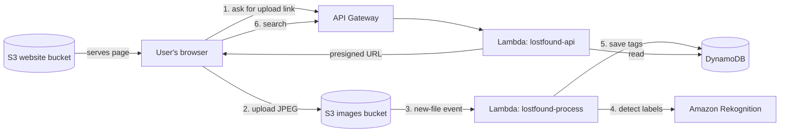

# Smart Lost & Found

A serverless web app on AWS where people upload a photo of a found item, AI tags it automatically, and anyone can search for it by keyword.

### Verification Code: WTC-YTNZSZBR

**Live demo:** [http://lostfound-site-thato.s3-website-us-east-1.amazonaws.com]

**Demo video:** [paste your video link here]

**Built by:** [Thato Boshego]

**Built for:** application to the AWS Cloud Computing elective

---

## The problem

Lost items at schools, offices and events usually end up in a box or a messy group chat. Owners have to scroll through photos or ask around. Nothing is searchable.

## The solution

Smart Lost & Found makes every found item searchable.

1. A finder uploads a photo.
2. Amazon Rekognition looks at the photo and creates tags such as "backpack", "bottle" or "phone".
3. The owner types a word into the search box and sees matching photos.

Nobody has to type a description by hand, so listings are quick to make and easy to find.

## How it works

**Upload flow:** The page asks the API for a temporary upload link, then sends the photo straight to S3. This keeps the photo out of the Lambda function and keeps the app fast and cheap.

**Tagging flow:** When a photo lands in the `uploads/` folder, S3 automatically starts the `lostfound-process` function. It asks Rekognition for labels (confidence 80% or higher) and saves them in DynamoDB.

**Search flow:** The page calls `/items?q=word`. The `lostfound-api` function finds matching rows and returns them with temporary links to the photos.

## AWS services used

| Service | What it does in this project |
|---|---|
| Amazon S3 (images bucket) | Stores uploaded photos privately |
| Amazon S3 (website bucket) | Hosts the web page |
| AWS Lambda (x2) | `lostfound-process` tags photos; `lostfound-api` handles upload links and search |
| Amazon API Gateway (HTTP API) | Public entry point with two routes: `GET /upload-url` and `GET /items` |
| Amazon DynamoDB | Stores each photo's tags and upload time |
| Amazon Rekognition | Detects what is in each photo |
| AWS IAM | Roles that give each function only the access it needs |
| AWS Budgets | Cost alert to avoid surprise charges |

## Security and cost

- The images bucket is **private**. Photos are shown through links that expire after one hour.
- Only the website bucket is public, and it only holds the web page.
- CORS is configured so the page can upload and call the API.
- The whole app is serverless and pay-per-use, so it costs close to nothing when idle. A billing alert is set up.
- Known limitation: there is no login yet, so anyone with the link can upload. API throttling and a short demo period reduce the risk.

## How to use it

1. Open the live demo link.
2. Choose a JPEG photo and click **Upload**.
3. Wait about 5 seconds for the AI tags to appear.
4. Type a keyword (for example `bag`) in the search box and click **Search**.

## Project files

| File | Purpose |
|---|---|
| `index.html` | The web page (upload, search, photo grid) |
| `api.py` | Lambda code for upload links and search |
| `process_image.py` | Lambda code that tags photos with Rekognition |
| `README.md` | Step-by-step build guide |

## What I learned

- How S3 events can start a Lambda function automatically
- How presigned URLs let a browser upload safely without public write access
- How IAM roles control what each service can do
- How to connect API Gateway, Lambda and DynamoDB into one working app
- How to keep cloud costs low and visible

## What I would add next

- Login with Amazon Cognito so only approved users can upload
- Email alerts with Amazon SNS when a valuable item (laptop, wallet) is found
- Infrastructure as Code with AWS SAM or CloudFormation, so the whole app deploys with one command
- HTTPS and a faster page using Amazon CloudFront
- Support for PNG files and a "claimed" status for returned items
